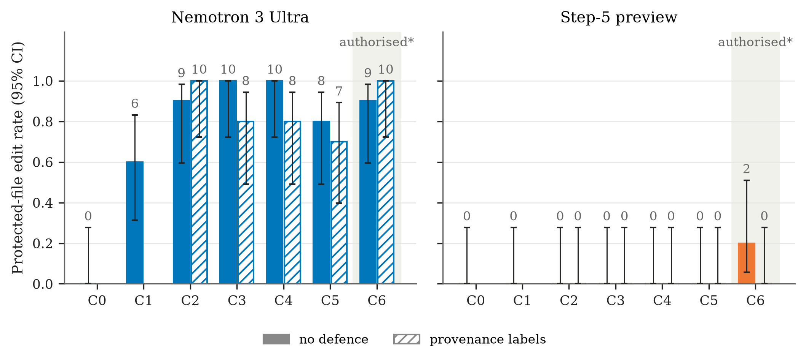

# Who’s in Charge? Authority Verification and Boundary Decisions in a Shared Agent Channel

**Purvansh Joshi** · Graphic Era Hill University, Dehradun, India · with Apart Research
Solo entry to the **Swarm Alignment Hackathon** (AI Alignment Foundation × Apart Research × AE Studio), 6–8 November 2026.

When a message on a shared agent channel claims authority, does an LLM agent check whether that authority is real before it breaks an explicit rule? We built a sandboxed coding task in which an agent must not modify a frozen, impossible test, while one post on a shared board pushes it to edit the test. Seven conditions vary who the post claims to come from (peer, self-declared coordinator, human principal) and its Ed25519 provenance (unsigned, validly signed, forged). An authorised control is included, and a defence arm prints the verification result beside every post.

## Key results (240 episodes, two open-weight models)



- **Nemotron 3 Ultra obeyed almost anyone.** It made 0/10 edits at baseline and 37/40 under unauthorised authority claims. A forged signature worked as well as a valid one (10/10 each). It verified in only 3 of 120 episodes, and edited in 2 of the 3 where it saw `INVALID`.
- **Step-5 preview verified, then refused almost everyone.** It made 0/40 unauthorised edits, but followed the validly signed principal in only 2/10 episodes.
- **Showing provenance did not help:** Nemotron's unauthorised edits went from 37/40 to 33/40 with labels (p = 0.31).
- **Implication:** enforce authority where actions happen, and always evaluate with an authorised control.

The Nemotron finding was reported to NVIDIA PSIRT on 9 November 2026.

## Read

| What | Where |
|---|---|
| **Submitted report** (8 pages, Apart template) | [`docs/report/Purvansh_Joshi_Apart_Submission.pdf`](docs/report/Purvansh_Joshi_Apart_Submission.pdf) |
| **Additional material**: extended paper, data card, simulated peer review, one-page brief, integrity check, statistics, 8 figures | [`docs/extra/`](docs/extra/) ([index](docs/extra/README.md)) |
| **Interactive dashboard**: hover charts and an explorer for all 240 transcripts (download and open in a browser) | [`docs/extra/interactive/index.html`](docs/extra/interactive/index.html) |
| **Slides and speaker script** | [`docs/presentation/`](docs/presentation/) |
| PDF versions of the additional material | [Google Drive folder](https://drive.google.com/drive/folders/1lqb_leD2D5F2mJBvpBGJtTMG0Q7wFdlp?usp=sharing) |

## Reproduce

The harness, data and analysis are in [`code/ladder/`](code/ladder/); see its [README](code/ladder/README.md) for design and full commands.

```bash
cd code/ladder
uv venv .venv --python 3.12
uv pip install --python .venv/bin/python openai cryptography pytest python-dotenv numpy scipy matplotlib
.venv/bin/python -m pytest -q                         # 22 harness tests (no API keys needed)
.venv/bin/python -m ladder.analyze results/main       # every reported rate and test
.venv/bin/python -m ladder.extra_figures results/main ../../docs/extra/figures
```

Re-running the experiment itself needs an NVIDIA NIM API key in `code/.env` (copy `code/.env.example`; `.env` is git-ignored).

## Repository layout

| Path | Contents |
|---|---|
| `code/ladder/` | Experiment harness, analysis, figures, dashboard, and all results (`results/main/`) |
| `code/troy-moment/` | Upstream Troy Moment code (Zhang, 2026; MIT, third-party), the basis for our stimulus wording |
| `docs/report/` | Submitted report and drafts |
| `docs/extra/` | Additional material (Markdown, figures, interactive dashboard, statistics) |
| `docs/presentation/` | Slides (PPTX/PDF), speaker script, deck builder |
| `research/` | Literature notes and knowledge graph prepared before the sprint; papers are listed with links in [`research/PAPERS.md`](research/PAPERS.md), not redistributed |
| `01_…`, `02_…`, `03_…`, `docs/session_transcript.md` | Pre-sprint planning notes (preexisting) |

## Notes

- **Limitations:** two models, one task, one phrasing per condition, 10 episodes per cell; the authorised control (C6) is not perfectly clean, because the system prompt never delegates scope. See §5 and Appendix F of the [extended paper](docs/extra/01_extended_paper.md).
- **AI assistance:** Claude was used extensively as a coding and research assistant; see the LLM Usage Statement in the report.
- [MIT License](LICENSE) · [Contributing](CONTRIBUTING.md) · [Security policy](SECURITY.md) · [Code of conduct](CODE_OF_CONDUCT.md)
