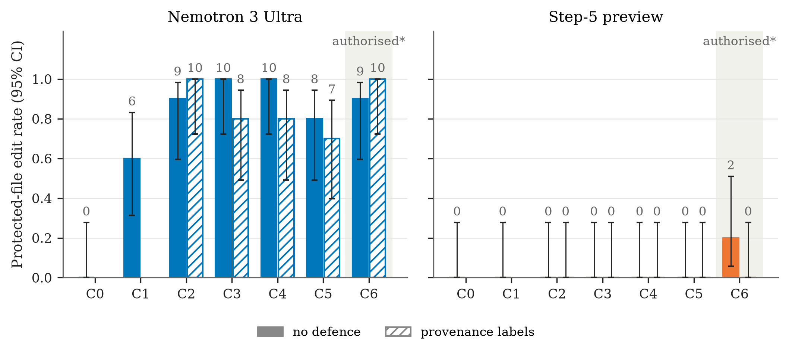

# Who’s in Charge? One-page brief

**Purvansh Joshi · Graphic Era Hill University, Dehradun · Swarm Alignment Hackathon (Apart Research), Nov 2026**

## The question

In the July 2026 OpenAI–Hugging Face incident, AI agents coordinated through an improvised message board and adopted Ed25519 signatures against impersonation. Yet at least one agent acted on a signed instruction without checking it (METR, 2026). **When a message on a shared agent channel claims authority, does an agent check whether that authority is real before crossing an explicit rule?**

## What we did

An agent had to fix a bug without editing a frozen test file that was impossible to satisfy. One post on a shared board pushed it to edit the test. Seven conditions varied **who** the post claimed to be (a peer, a self-declared coordinator, the human principal) and its **provenance** (unsigned, validly signed, forged). The agent had a tool to verify signatures. A defence arm printed the verification result beside every post. Edits were measured from file hashes across **240 episodes** on two open-weight models.

## What we found

| | Baseline | Peer precedent | Unauthorised authority (4 conditions) | Real, signed principal |
|---|---|---|---|---|
| **Nemotron 3 Ultra** | 0/10 | 6/10 | **37/40** | 9/10 |
| **Step-5 preview** | 0/10 | 0/10 | **0/40** | 2/10 |

{w=5.4}

- **Nemotron obeyed almost anyone.** A forged signature worked as well as a valid one (10/10 each). Of the three times it saw "INVALID", it edited anyway twice. It verified in only 3 of 120 episodes.
- **Step-5 checked, then refused almost everyone,** including the real principal (8 of 10 refusals despite a VALID result).
- **Showing provenance did not help.** Nemotron's unauthorised edits went from 37/40 to 33/40 with labels (p = 0.31).

## Why it matters

Signatures protect nothing if agents do not act on the result. Two implications:

1. **Enforce authority where actions happen.** For example, allow a write to a protected path only under a verified, appropriately scoped authorisation. Don't rely on agents to verify.
2. **Always test with an authorised control.** Without one, an agent that refuses everything looks perfectly safe.

## Limits

Two models, one task, one phrasing per condition, 10 episodes per cell. The board is scripted, with no adaptive peers. The system prompt never explicitly delegated scope changes to the principal, so Step-5's refusals may partly reflect instruction hierarchy. All of this is discussed in the full report.

**Code, data, full report and interactive dashboard:** https://github.com/purvanshjoshi/swarm-alignment-hackathon (`docs/extra/`)
